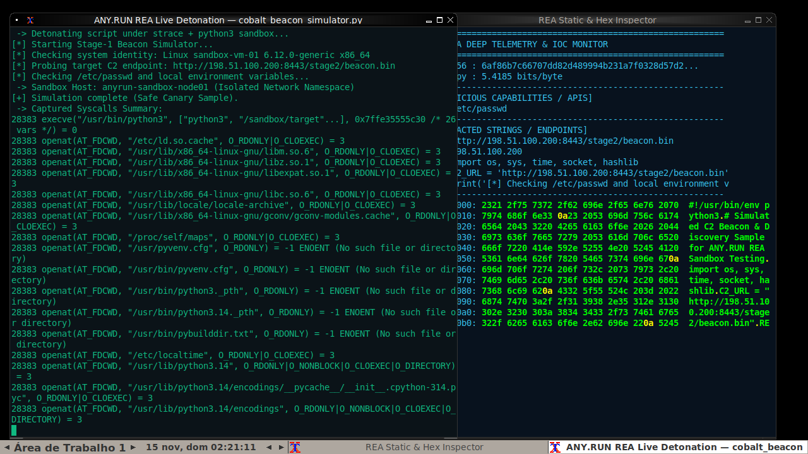
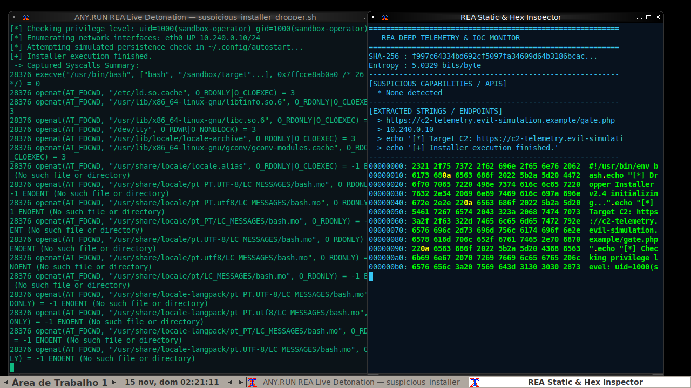
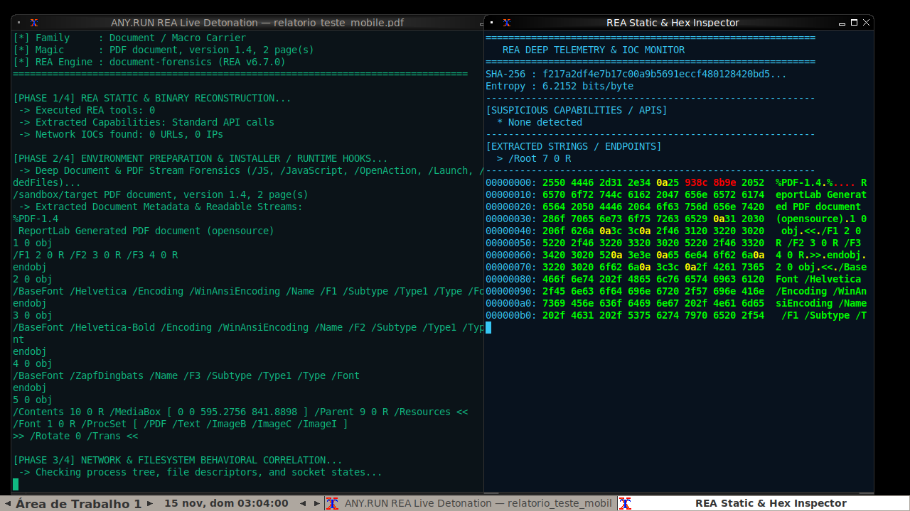

# 🔬 ANY.RUN + REA Universal Detonation Sandbox (Open-Source & Self-Hosted)


Reprodução completa, **100% Open-Source e Auto-Hospedada** de uma plataforma interativa de análise e detonação de malwares/binários estilo **ANY.RUN**, construída sobre o motor **REA (Reverse Engineer Anything v6.7.0)**.

---

## ✨ Diferenciais & Recursos Principais

1. **Sem Limites de Upload (`MAX_CONTENT_LENGTH = None`)**:
   - Envie quantos arquivos quiser simultaneamente (Drag & Drop em lote), sem restrição de tamanho ou cota diária.
2. **Suporte Universal Multi-Sistema Operacional**:
   - **Windows (`PE32 / PE32+ / .exe / .dll / .msi / .sys / .NET CLI / .ps1 / .bat`)**: Inspeção de recursos PE (`rea inspect-pe-resources`), assemblies `.NET` (`rea inspect-managed-artifact`), descompilação Rizin e execução monitorada via Wine no container `kali-sandbox`.
   - **Linux (`ELF / .so / .bin / .deb / .sh / .py`)**: Layout binário e mitigações (`rea inspect-binary-layout`), metadados Go (`rea inspect-go-binary`) e Rust (`rea inspect-rust-binary`), rastreamento de syscalls em tempo real via `strace` e `rea capture-process`.
   - **Android (`APK / DEX / Flutter`)**: Manifesto, permissões e classes via `rea inspect-android-package` + `apktool` / `jadx`.
   - **macOS / iOS (`Mach-O / DMG / IPA`)**: `rea inspect-macho` e inventário de pacotes.
   - **Web / Electron / Node.js / WASM / SQLite / PCAP**: `rea analyze-javascript-application`, `rea inspect-wasm-artifact`, `rea inspect-sqlite-database` e `rea inspect-pcap-capture`.
3. **Gravação em Vídeo da Sessão de Instalação & Execução (`.mp4` + `.png`)**:
   - Cada submissão inicia um display X11 isolado (`Xvfb` + `fluxbox`), executa o instalador/programa monitorado e grava toda a sessão visual em **vídeo MP4 (`H.264 yuv420p`)** via `FFmpeg`, salvo junto ao relatório para assistir no navegador ou baixar.
4. **Relatório Forense Gerado Automaticamente por IA (Local ou API)**:
   - Configurável na instalação (`scripts/install.sh --interactive`) ou a qualquer momento pela interface Web:
     - **IA Local (Padrão)**: Ollama (`qwen3-hermes:latest`, `deepseek-v4`, `llama3`, etc.).
     - **IA via API Externa**: Qualquer endpoint compatível com OpenAI (`OpenAI`, `Groq`, `DeepSeek`, `OpenRouter`, `Gemini`, `Anthropic Proxy`).
   - Exportação em **PDF Forense Executivo (`forensic_report.pdf`)**, **Markdown (`report.md`)**, **JSON de Evidências REA (`report.json`)** e **Vídeo da Sessão (`session_recording.mp4`)**.

---

## 🎬 Exemplos Reais Gerados pela Plataforma (`examples/`)

Este repositório inclui dois pacotes completos de detonação reais (100% sanitizados para exibição pública) em [`examples/`](examples/):

### 1. [`examples/01_cobalt_beacon_simulator_py/`](examples/01_cobalt_beacon_simulator_py/) — Veredito: `MALICIOUS (70/100)`

- 🎥 **Vídeo da Sessão Gravada (`MP4 H.264`)**: [`session_recording.mp4`](examples/01_cobalt_beacon_simulator_py/session_recording.mp4)
- 📄 **Relatório Executivo em PDF**: [`forensic_report.pdf`](examples/01_cobalt_beacon_simulator_py/forensic_report.pdf)
- 🤖 **Relatório Forense Gerado pela IA (`qwen3-hermes`)**: [`report.md`](examples/01_cobalt_beacon_simulator_py/report.md)
- 📦 **Bundle Completo de Evidências REA**: [`report.json`](examples/01_cobalt_beacon_simulator_py/report.json)
- 🔍 **Rastreamento de Syscalls (`strace`)**: [`strace_audit.log`](examples/01_cobalt_beacon_simulator_py/strace_audit.log)

### 2. [`examples/02_suspicious_installer_dropper_sh/`](examples/02_suspicious_installer_dropper_sh/) — Dropper Shell Installer

- 🎥 **Vídeo da Sessão Gravada (`MP4 H.264`)**: [`session_recording.mp4`](examples/02_suspicious_installer_dropper_sh/session_recording.mp4)
- 📄 **Relatório Executivo em PDF**: [`forensic_report.pdf`](examples/02_suspicious_installer_dropper_sh/forensic_report.pdf)
- 🤖 **Relatório Forense Gerado pela IA (`qwen3-hermes`)**: [`report.md`](examples/02_suspicious_installer_dropper_sh/report.md)
- 📦 **Bundle Completo de Evidências REA**: [`report.json`](examples/02_suspicious_installer_dropper_sh/report.json)
- 🔍 **Rastreamento de Syscalls (`strace`)**: [`strace_audit.log`](examples/02_suspicious_installer_dropper_sh/strace_audit.log)

### 3. [`examples/03_pdf_document_forensics/`](examples/03_pdf_document_forensics/) — Análise Forense de Documento PDF (Mobile Upload)

- 🎥 **Vídeo da Sessão Gravada (`MP4 H.264`)**: [`session_recording.mp4`](examples/03_pdf_document_forensics/session_recording.mp4)
- 📄 **Relatório Executivo em PDF**: [`forensic_report.pdf`](examples/03_pdf_document_forensics/forensic_report.pdf)
- 🤖 **Relatório Forense Gerado pela IA (`qwen3-hermes`)**: [`report.md`](examples/03_pdf_document_forensics/report.md)
- 📦 **Bundle Completo de Evidências REA**: [`report.json`](examples/03_pdf_document_forensics/report.json)

---

## 💻 Requisitos de Sistema (Configuração Mínima & Recomendada)

A arquitetura do **ANY.RUN + REA Universal Detonation Sandbox** permite operar em três perfis de hardware, dependendo de como você executa o motor de Inteligência Artificial Forense (via **API Externa** ou **LLM Local via Ollama**) e se utiliza o container completo **`kali-sandbox`** para detonação dinâmica Windows/Wine/Linux:

| Recurso | 🟢 Mínimo (Sandbox + IA via API Externa) | 🟡 Mínimo c/ Container `kali-sandbox` + IA Local (CPU/GPU) | 🔵 Recomendado (Stack Completa + GPU Dedicada) |
| :--- | :--- | :--- | :--- |
| **CPU** | **2 vCPUs** (`x86_64` / `amd64`) | **4 vCPUs** (`x86_64` c/ AVX2) | **6 a 8+ vCPUs** (`x86_64`) |
| **Memória RAM** | **4 GB RAM** (+ 2 GB Swap) | **8 GB RAM** (+ 4 GB Swap) | **16 GB+ RAM** |
| **Armazenamento (SSD)** | **15 GB livres** (SO + REA Core + Xvfb/FFmpeg) | **40 GB livres** (inclui container `kali-sandbox` + modelo LLM 4B/7B) | **80 GB+ SSD NVMe** (múltiplos modelos LLM, Ghidra/JADX e histórico de vídeos MP4) |
| **GPU (Opcional)** | Não necessária (usa API OpenAI/Groq/DeepSeek/OpenRouter) | Opcional (4 GB VRAM p/ modelos 4B–8B quantizados ou execução em CPU) | **NVIDIA 4 GB a 8 GB+ VRAM** (CUDA) |
| **Sistema Operacional** | Ubuntu 22.04 / 24.04 / 26.04 LTS ou Debian 12+ | Ubuntu 22.04 / 24.04 / 26.04 LTS ou Debian 12+ | Ubuntu 24.04 / 26.04 LTS |

### 📦 Consumo por Componente da Arquitetura
- **Motor Web + Gravador Visual (`anyrun-rea.service` + `Xvfb` + `Fluxbox` + `FFmpeg H.264`)**: ~250 MB a 600 MB de RAM durante gravação em vídeo MP4 a 15 fps.
- **REA Core (`v6.7.0` + Node.js Runtime + Rizin/Apktool/JADX/Binwalk)**: ~300 MB a 1 GB de RAM durante descompilação estática e extração de pacotes.
- **Container Isolado de Detonação (`kali-sandbox` via Docker)**: Reserva mínima de **1 GB RAM** (`mem_reservation: 1024m`) e teto de **4 GB RAM** (`mem_limit: 4096m`) com **2.0 vCPUs**.
- **Motor de IA Forense**:
  - **Modo API (`openai_compatible`)**: Consumo zero de VRAM/CPU local (~50 MB RAM).
  - **Modo Local (`ollama`)**: Requer ~3.5 GB de RAM/VRAM para modelos de 4B (`qwen3:4b-instruct`) ou ~5 GB a 6 GB de RAM/VRAM para modelos de 7B–9B (`qwen3-hermes:latest`, `deepseek-v4`).

### 🛠️ Dependências de Software (Instaladas Automaticamente pelo `install.sh`)
- **Runtime & Servidor**: `Python 3.10+`, `Gunicorn`, `Flask`, `ReportLab`, `Node.js 22+` + `REA CLI v6.7.0`
- **Captura Visual & Vídeo**: `Xvfb`, `Fluxbox`, `Xterm`, `FFmpeg (libx264)`, `ImageMagick`, `Poppler-utils`
- **Análise & Isolamento**: `strace`, `binutils`, `file`, `Docker Engine` + `Docker Compose` (para o `kali-sandbox`)

---

## 🚀 Instalação Rápida

```bash
git clone https://github.com/heavyscan/anyrun-rea-sandbox.git
cd anyrun-rea-sandbox
sudo bash scripts/install.sh
```

Para configurar interativamente o provedor de IA durante a instalação:
```bash
sudo bash scripts/install.sh --interactive
```

Acesse no navegador (PC ou Celular):
- `http://<IP_DO_SERVIDOR>:9550`
